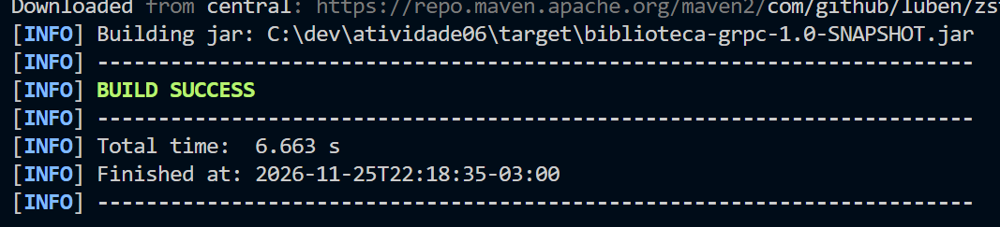
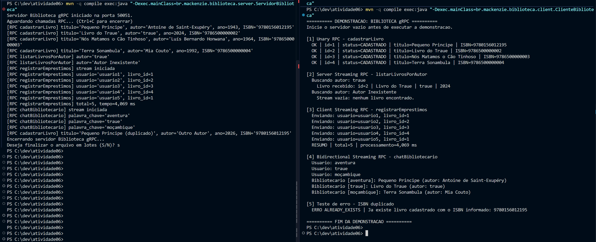

# Atividade: Sistema de Gerenciamento de Biblioteca Digital com gRPC

Aplicação em Java 17 e Maven que demonstra os quatro tipos de RPC (Unary, Server Streaming, Client Streaming e Bidirectional Streaming) usando Protocol Buffers, com livros e empréstimos armazenados em memória.

## Integrantes
- Pedro Henrique Carvalho Pereira - 10418861
- Mateus Ribeiro Cerqueira - 10443901


## Compilação

Na raiz do projeto (onde está o `pom.xml`):

```bash
mvn clean compile
mvn clean package
```


## Execução

Abrir dois terminais na pasta do projeto. Executar primeiro o servidor e manter esse terminal aberto.

**Terminal 1 - Servidor:**

```bash
mvn exec:java -Dexec.mainClass=br.mackenzie.biblioteca.server.ServidorBiblioteca
```

**Terminal 2 - Cliente:**

```bash
mvn exec:java -Dexec.mainClass=br.mackenzie.biblioteca.client.ClienteBiblioteca
```


## Resultado

### Compilação (`mvn clean package`)



### Execução: servidor (esquerda) e cliente (direita)

O servidor registra o log de cada chamada recebida e o cliente demonstra os quatro tipos de RPC: Unary (`cadastrarLivro`, 4 livros), Server Streaming (`listarLivrosPorAutor`, com autor existente e inexistente), Client Streaming (`registrarEmprestimos`, 5 empréstimos), Bidirectional Streaming (`chatBibliotecario`, 3 mensagens) e o erro `ALREADY_EXISTS` ao cadastrar ISBN duplicado.


 